# Projeto M2.2 — Filtragem na frequência, morfologia e segmentação

Universidade do Vale do Itajaí — Curso de Ciência da Computação

Disciplina: Processamento de Imagens. Professor: Felipe Viel.

Autores: Gustavo Corrêa de Mello, Heloisa Cavalcante Born e João Paulo Jorge Aimi.

## Resumo

Este trabalho compara os efeitos da filtragem no domínio da frequência sobre a segmentação de uma imagem natural e aplica morfologia binária à contagem de objetos em duas imagens indicadas no enunciado. Na Parte 1, ruído gaussiano controlado degrada uma imagem do VOC2012; máscaras Gaussianas e Butterworth próprias antecedem Watershed e SLIC. O filtro selecionado eleva o PSNR de 22,61 para 26,12 dB. O F1 de estabilidade de contornos melhora de 0,561 para 0,736 no SLIC e de 0,679 para 0,685 no Watershed. Na Parte 2, limiarização, fechamento, preenchimento de buracos e abertura produzem contagens finais de 16 e 56 componentes. Os resultados mostram ganhos de restauração e correção de formas, mas também limitações na preservação de contornos e na separação de objetos encostados. As implementações e os resultados intermediários são apresentados em notebook pré-executado.

Palavras-chave: filtragem na frequência; Watershed; SLIC; morfologia; componentes conectados.

## 1. Enunciado e contexto
O projeto M2.2 da disciplina solicita duas abordagens complementares de processamento de imagens. A primeira investiga como o ruído e a filtragem na frequência afetam a segmentação de uma imagem natural com Watershed e SLIC. A segunda utiliza limiarização e operações morfológicas para corrigir falhas em imagens binárias e examinar sua influência na contagem de objetos.

O objetivo é relacionar as escolhas de processamento aos resultados quantitativos e visuais, sem presumir que toda filtragem ou operação morfológica melhora a saída. Para isso, comparam-se intensidades, regiões, contornos e contagens por etapa. O desenvolvimento utiliza Python e implementações próprias das máscaras, operações pontuais, morfologia, métricas e contagem; NumPy fornece as operações numéricas e a FFT. Foram mantidos os métodos e as imagens definidos no enunciado, inclusive quando revelam limitações como células encostadas.

## 2. Materiais e metodologia
### 2.1 Dados e reprodutibilidade — todos
A Parte 1 usa o JPEG original `2009_003974.jpg`, 500 × 335 pixels, RGB, pertencente ao conjunto Main/train do pacote VOC2012. A escolha favorece a inspeção de um objeto grande sobre fundo relativamente uniforme. O arquivo foi extraído sem alteração do pacote oficial e sua integridade é registrada por SHA-256. A identificação da prévia `car_04` foi confirmada por anotação e inspeção visual. O XML indica ausência de máscara de segmentação, razão pela qual os contornos da imagem limpa são utilizados como referência de estabilidade de cada método, não como verdade humana.

A Parte 2 utiliza exatamente os dois arquivos vinculados no enunciado: `gap-region-filling.tif`, uma imagem binária de 512 × 512 pixels com anéis e falhas, e `002f20ad-2ace-499c-9335-c9080bc3e6b5.png`, uma imagem RGB de 1600 × 1200 pixels de esfregaço de sangue. As fontes e instruções de obtenção estão em `data/README.md`; o script `scripts/baixar_dados.py` verifica o checksum das três entradas.

O ambiente de referência utiliza Python 3.12.14, NumPy 2.5.4, Matplotlib 3.11.2 e Pillow 13.0.0, com versões das dependências fixadas em `requirements.txt`. Imagens são representadas por arrays float64 em [0,1], máscaras por booleanos e rótulos por inteiros com zero reservado ao fundo. As comparações da Parte 1 usam uma única realização de ruído, com seed 42. Os parâmetros específicos são descritos nas subseções seguintes. Todas as etapas são executadas sequencialmente no notebook `notebooks/trabalho_m2_2.ipynb`.
### 2.2 Filtragem na frequência — Born
A imagem original VOC2012 `2009_003974.jpg`, RGB de 500 × 335 pixels, foi convertida manualmente de inteiros de 8 bits para float64 em [0,1], sem redimensionamento. Adicionou-se ruído gaussiano de média zero e desvio padrão 0,08, independente por canal, com gerador NumPy e seed 42. Os valores foram limitados a [0,1]; portanto, o ruído efetivo sofre alteração perto dos extremos.

Implementaram-se duas máscaras passa-baixa radiais: Gaussiana, $H_G(D)=\exp[-D^2/(2D_0^2)]$, e Butterworth, $H_B(D)=1/[1+(D/D_0)^{2n}]$, com ordem $n=2$. A distância $D$ é calculada na grade de frequências em ciclos/pixel. A grade de $D_0$ foi 0,02; 0,04; 0,06; 0,08; 0,10; 0,12; 0,16; 0,20; 0,25; 0,35 e 0,50. O mesmo parâmetro não implica respostas equivalentes entre as famílias: o ganho em $D_0$ é aproximadamente 0,607 no Gaussiano e 0,5 no Butterworth.

Aplicou-se padding refletido de 32 pixels em cada borda. Para cada canal, calculou-se FFT2 e centralização, multiplicou-se o espectro complexo pela máscara e aplicou-se a transformada inversa após desfazer a centralização. A parte real foi recortada ao tamanho original e limitada a [0,1], sem normalização por mínimo e máximo. NumPy fornece a FFT e operações numéricas; a máscara, a filtragem por multiplicação e as métricas foram implementadas no projeto.

Calculou-se $MSE=\frac{1}{N}\sum(I-I_f)^2$ sobre todos os pixels e canais e $PSNR=10\log_{10}(1/MSE)$, com a imagem limpa como referência. A comparação usa a mesma realização de ruído em todas as 22 configurações. O maior PSNR da grade define a entrada filtrada para a próxima etapa. Trata-se de ajuste demonstrativo com referência conhecida na mesma imagem/seed, sem validação independente. SSIM, opcional no enunciado, não foi incluído.

### 2.3 Watershed e SLIC — Gustavo
As três condições (original, ruidosa e filtrada) foram lidas dos arrays float64 de `resultados/frequencia/entradas_segmentacao.npz`, sem gerar ruído novo, e segmentadas pelos dois métodos com os mesmos parâmetros. Assim, a diferença entre resultados de um mesmo método se deve apenas à imagem de entrada.

**Watershed.** A imagem é tratada como um relevo topográfico cujas cristas devem coincidir com as bordas. A entrada RGB é convertida para cinza com os pesos da ITU-R BT.601 (0,299 R + 0,587 G + 0,114 B), e o relevo é a magnitude do gradiente de Sobel, $\sqrt{G_x^2+G_y^2}$, calculada com convolução própria. A convolução replica os pixels da borda no padding, para que a moldura da imagem não gere uma borda falsa, e o gradiente não é normalizado pelo máximo, para que as três condições fiquem na mesma escala. Os marcadores são as regiões conexas (8-vizinhança, busca em largura) de pixels com gradiente menor ou igual ao percentil 75 do próprio gradiente, mantidas apenas as que têm pelo menos 0,1% dos pixels da imagem (168 pixels no carro). A inundação segue o algoritmo por fila de prioridade (Meyer): os pixels dos marcadores entram numa heap ordenada pela altura; o pixel mais baixo sai primeiro e transmite seu rótulo aos vizinhos ainda sem rótulo, que entram na fila. Empates de altura são resolvidos pela ordem de chegada. Todo pixel recebe o rótulo de uma bacia, e os contornos são os pixels cujo vizinho à direita ou abaixo tem outro rótulo.

Os parâmetros são relativos à imagem porque o enunciado prevê teste com outras imagens. Um limiar absoluto de 0,1 funcionou no carro limpo, mas com ruído σ = 0,05 deixou apenas 2 marcadores no carro e nenhum em três imagens do material da disciplina. A área mínima é o que evita a supersegmentação: sem ela, a imagem original produz 791 regiões, contra 20 com a área mínima de 0,1%.

**SLIC.** O SLIC é um k-means local no espaço de cor e posição. Para $N$ pixels e $K$ superpixels, os centros começam numa grade de passo $S=\sqrt{N/K}$, e cada pixel é atribuído ao centro de menor distância
$$D=\sqrt{d_c^2+\left(\frac{m}{S}\right)^2 d_s^2},$$
em que $d_c$ é a distância euclidiana em RGB (escala 0–255), $d_s$ a distância espacial e $m$ a compacidade. Cada centro só disputa os pixels de uma janela $2S\times 2S$ ao seu redor, o que torna o custo linear no número de pixels. Depois da atribuição, cada centro passa à média de posição e cor dos seus pixels; o ciclo se repete 10 vezes. Usaram-se $K=200$ e $m=20$, meio-termo visual entre $m=5$ (contornos seguem a cor, formas irregulares) e $m=40$ (quase uma grade regular). No carro, $S=28$ e a grade inicial tem 216 centros.

Foram feitas duas adaptações ao exemplo da disciplina. Primeiro, a distância é calculada para a janela inteira de cada centro em uma operação vetorizada, sem alterar o algoritmo. Segundo, acrescentou-se o passo de conectividade do SLIC original (Achanta et al., 2012): o k-means não obriga um rótulo a formar uma peça só, e no carro os 216 rótulos chegavam a até 3.874 componentes desconexos, o que falsearia a contagem de regiões. Componentes com menos de $S^2/4$ pixels são incorporados ao componente vizinho já visitado.

**Método de comparação.** O enunciado pede a comparação do número de regiões e dos contornos em relação à original. Como a imagem não tem máscara de segmentação declarada (`segmented=0`), a referência de cada método é a sua própria segmentação da imagem original limpa. A medida resultante é de **estabilidade frente ao ruído e à filtragem**, não de acerto em relação a uma segmentação humana. Os contornos foram comparados por precisão e revocação com tolerância de 2 pixels, como no benchmark BSDS (Martin et al., 2004): um pixel de contorno é considerado correspondido se houver contorno do outro mapa a até 2 pixels, verificado por dilatação binária própria com elemento quadrado 5 × 5. A precisão é a fração do contorno obtido que existe na referência (baixa indica bordas falsas); a revocação é a fração da referência reencontrada (baixa indica bordas perdidas); o F1 é a média harmônica das duas. A comparação visual sobrepõe os contornos às imagens e, num recorte da frente do carro, colore cada pixel de contorno conforme coincida com a referência, seja falso ou tenha sido perdido.

As funções estão em `src/segmentacao.py` e foram verificadas por 12 testes com entradas de resposta conhecida (`tests/test_segmentacao.py`): degrau preto/branco para o gradiente, duas bacias separadas por uma crista para a inundação, imagem de duas cores para o SLIC, pixel isolado para a conectividade, fronteira deslocada de 1 pixel para a tolerância da métrica, imagem uniforme e ausência de marcadores. Na imagem uniforme, o marcador único é preservado como rótulo 1 mesmo quando não há fundo. Caso o filtro de área elimine todos os marcadores, a execução informa um erro para ajustar os parâmetros, em vez de tratar um mapa sem rótulos como segmentação válida.
### 2.4 Morfologia e contagem — João Paulo
Foram usadas as duas imagens vinculadas no enunciado, obtidas do repositório do professor (`data/README.md`). A **Imagem 1** (`gap-region-filling.tif`, 512 × 512, cinza 8 bits) já é binária: anéis brancos com buraco central em fundo preto. A **Imagem 2** (`002f20ad-…png`, 1600 × 1200, RGB) é um esfregaço de sangue corado, com hemácias roxas de centro claro em fundo branco. As imagens são convertidas para float em [0,1] e para cinza pela mesma função própria da Parte 1 (pesos BT.601). A pipeline segue a ordem do enunciado: gaussiano leve, limiarização, fechamento, preenchimento de buracos, abertura e contagem.

**Pré-processamento e limiarização.** O filtro gaussiano é aplicado por convolução própria separável (núcleo 1D nas linhas e depois nas colunas, raio $3\sigma$, borda replicada). Usou-se $\sigma=2$ na Imagem 2, para suavizar a textura interna das hemácias, e $\sigma=0$ na Imagem 1, que já é binária e só teria as bordas borradas. O limiar é o de Otsu, calculado sobre o histograma de 256 níveis: para cada nível $t$, os pixels se dividem nas classes $\le t$ e $> t$, e escolhe-se o $t$ que maximiza a variância entre classes, $\sigma_b^2(t)=\omega_0\,\omega_1\,(\mu_0-\mu_1)^2$, calculada para todos os níveis de uma vez com somas acumuladas. Como o histograma arredonda o cinza para o nível mais próximo, o limiar devolvido em [0,1] é $(t+0{,}5)/255$, de modo que a comparação `cinza > limiar` separe exatamente as mesmas classes. Na Imagem 1 o objeto é claro (pixels acima do limiar); na Imagem 2 é escuro (pixels abaixo).

**Morfologia.** O elemento estruturante é um disco (pixels a até $r$ do centro), isotrópico e adequado a objetos arredondados. A dilatação é o OU lógico de cópias da máscara deslocadas por cada posição do elemento refletido, $A\oplus B$; a erosão é o E lógico das cópias deslocadas, $A\ominus B$. O laço percorre as posições do elemento, não os pixels. Fora da imagem conta como fundo na dilatação e como objeto na erosão, para que a moldura não corroa células cortadas pela borda; com isso o fechamento nunca remove pixels e a abertura nunca acrescenta. O **fechamento** ($(A\oplus B)\ominus B$, disco de raio 2 nas duas imagens) une fragmentos e fecha frestas menores que o elemento. A **abertura** ($(A\ominus B)\oplus B$, raio 2 na Imagem 1 e 4 na Imagem 2) remove partículas menores que o elemento.

**Preenchimento de buracos.** Usou-se o preenchimento de regiões por dilatação condicional (Gonzalez e Woods): a partir dos pixels de fundo da borda da imagem, $X_k=(X_{k-1}\oplus B)\cap A^c$ até a estabilidade, com $B$ em cruz. O fundo é "inundado" de fora para dentro sem atravessar o objeto; o que não é alcançado é buraco e passa a ser objeto. O par de conectividades é complementar: objetos em 8-vizinhança e fundo em 4-vizinhança, para que a inundação não passe pela quina diagonal onde o objeto está conectado. Um buraco que toca a borda da imagem é, por definição, fundo e não é preenchido.

**Contagem própria.** A rotulagem de componentes conexos percorre a imagem em ordem de leitura; ao encontrar um pixel de objeto sem rótulo, abre um rótulo novo e o propaga por busca em largura aos vizinhos de objeto (8-vizinhança). Cada pixel entra na fila uma única vez, então o custo é linear no número de pixels, e o número de rótulos é o número de objetos. Não se usaram funções prontas de rotulagem (`scipy.ndimage.label`, `cv2.connectedComponents` ou `skimage.measure.label`). A contagem é feita após cada etapa, para comparar antes e depois do gap-filling, e cada objeto final recebe uma cor e o seu número no centroide.

As funções estão em `src/morfologia.py` e `src/contagem.py` e foram verificadas por 13 testes com resposta conhecida (`tests/test_morfologia.py`): dilatação e erosão contra a definição com elemento assimétrico (o que verifica a reflexão), fechamento que só acrescenta e abertura que só remove, abertura eliminando uma partícula de 1 pixel, fechamento unindo dois quadrados separados por 1 coluna, preenchimento de um buraco interno, losango ligado pelas quinas (preenchido com fundo em 4, não com fundo em 8), buraco aberto para fora que não é preenchido, Otsu em duas populações, diagonal com 1 objeto em 8-vizinhança e 4 em 4-vizinhança, renumeração após área mínima, medidas e a pipeline completa numa célula oca.

## 3. Códigos importantes
Na frente da Born, `src/frequencia.py` implementa ruído, máscaras e filtragem; `src/metricas.py` implementa MSE e PSNR. O trecho central é:

```python
f = np.fft.fftshift(np.fft.fft2(padded, axes=(0, 1)), axes=(0, 1))
g = f * h[..., None]  # máscara comum aos canais RGB
inversa = np.fft.ifft2(np.fft.ifftshift(g, axes=(0, 1)), axes=(0, 1))
```

A máscara é calculada pelo grupo, multiplicando amplitudes complexas sem descartar a fase antes da inversa. O notebook `notebooks/rascunhos/01_frequencia.ipynb` apresenta as equações, executa o experimento e exibe as saídas.

Na frente de Gustavo, `src/segmentacao.py` implementa gradiente, rotulagem, marcadores, inundação, SLIC, conectividade e a métrica de contorno. O núcleo do Watershed é a fila de prioridade, que faz a "água" subir nível a nível:

```python
while fila:
    _, _, i, j = heappop(fila)            # pixel mais baixo ainda não processado
    for dy, dx in VIZINHOS_8:
        ni, nj = i + dy, j + dx
        if 0 <= ni < h and 0 <= nj < w and rotulos[ni][nj] == 0:
            rotulos[ni][nj] = rotulos[i][j]  # herda a bacia do vizinho
            heappush(fila, (altura[ni][nj], ordem, ni, nj))
            ordem += 1
```

No SLIC, a atribuição de cada centro é calculada para toda a janela $2S\times 2S$ de uma vez:

```python
dc2 = ((img[y0:y1, x0:x1] - cor) ** 2).sum(axis=2)
ds2 = (yy[y0:y1, x0:x1] - yc) ** 2 + (xx[y0:y1, x0:x1] - xc) ** 2
d = np.sqrt(dc2 + (m / S) ** 2 * ds2)
menor = d < dist[y0:y1, x0:x1]           # o pixel fica com o centro de menor D
```

O notebook `notebooks/rascunhos/02_segmentacao.ipynb` executa os testes, os dois métodos e a comparação.

Na frente de João Paulo, `src/morfologia.py` implementa gaussiano, Otsu, elemento estruturante, erosão, dilatação, fechamento, abertura e preenchimento; `src/contagem.py` implementa a rotulagem, medidas e cores. A dilatação percorre o elemento estruturante, não os pixels:

```python
p = np.pad(mascara, ((ry, ry), (rx, rx)), constant_values=False)
saida = np.zeros((h, w), dtype=bool)
for dy, dx in zip(*np.nonzero(ee[::-1, ::-1])):   # elemento refletido na dilatacao
    saida |= p[dy:dy + h, dx:dx + w]               # OU da máscara deslocada
```

O preenchimento de buracos inunda o fundo a partir da borda até a estabilidade:

```python
while True:
    novo = dilatar(inundado, b) & fundo    # dilatacao condicional no fundo
    if np.array_equal(novo, inundado):
        return ~inundado                   # o que a água não alcança é objeto ou buraco
    inundado = novo
```

O notebook `notebooks/rascunhos/03_celulas.ipynb` executa os testes, a pipeline nas duas imagens, a contagem por etapa e as figuras.

## 4. Resultados
### 4.1 Filtragem — Born
A imagem ruidosa apresentou **PSNR de 22.6133 dB** e MSE de 0.00547858. O melhor resultado entre as 22 configurações avaliadas foi o filtro **Gaussiano com corte 0,25 ciclos/pixel**, com **26.1186 dB**, MSE de **0.00244423** e ganho de **3.5053 dB**. O melhor Butterworth na grade teve corte 0,35 e PSNR 25,9753 dB. A diferença é pequena e vale apenas para este experimento.

O corte Gaussiano 0,02 produziu 18,0294 dB, abaixo da imagem ruidosa: filtrar mais intensamente não implica melhor restauração. O corte 0,50 deixou mais ruído e atingiu 24,7833 dB. Isso evidencia a troca entre redução de ruído e preservação de detalhes.

Na inspeção do painel e do recorte comum da roda dianteira, o filtro escolhido reduz a granulação, mas suaviza detalhes das rodas, janelas e carroceria. Os espectros mostram atenuação das altas frequências, usando a mesma escala logarítmica antes e depois. O maior resíduo imaginário da inversa foi 4.806e-16, compatível com arredondamento numérico.

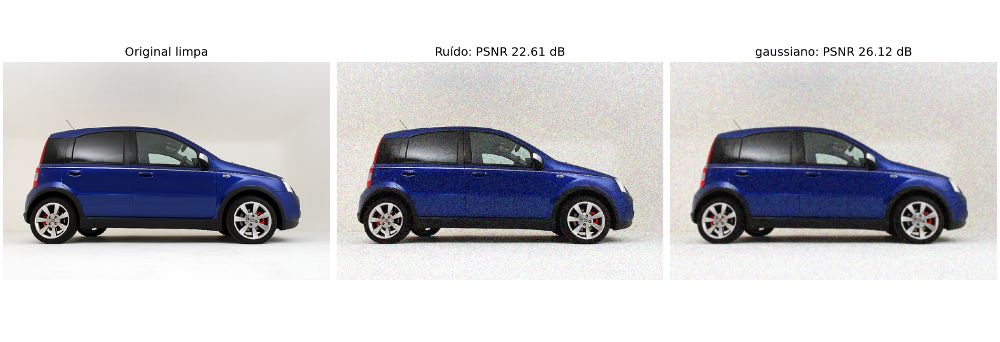


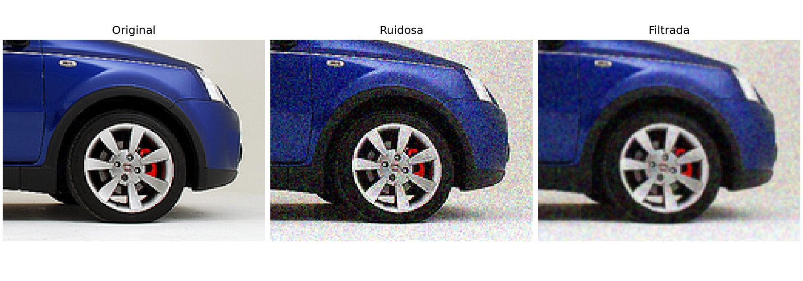

A tabela completa está em `resultados/frequencia/comparacao_filtros.csv`. Os arrays float64 em `entradas_segmentacao.npz` preservam os dados para Gustavo; os PNGs são cópias arredondadas para visualização. Parâmetros, versões e fonte estão em `parametros.json`.

O ganho de PSNR mede restauração e, isoladamente, **não demonstra melhoria de Watershed ou SLIC**. A avaliação específica de estabilidade dos contornos está na seção 4.2. A imagem escolhida não tem máscara de segmentação declarada; não se usa sua caixa de detecção como referência pixel a pixel.

### 4.2 Segmentação — Gustavo, com montagem dos painéis pela Born
Na imagem original, o Watershed produziu **20 regiões** e o SLIC, **203**. Cada método levou cerca de 1 s por imagem. A Tabela 1 resume as três condições; a referência de cada linha é a segmentação da original pelo mesmo método, por isso a original tem precisão, revocação e F1 iguais a 1.

| Método | Imagem | Regiões | Precisão | Revocação | F1 |
|---|---|---:|---:|---:|---:|
| Watershed | Original | 20 | 1,000 | 1,000 | 1,000 |
| Watershed | Ruidosa | 9 | 0,888 | 0,550 | 0,679 |
| Watershed | Filtrada | 11 | 0,891 | 0,557 | 0,685 |
| SLIC | Original | 203 | 1,000 | 1,000 | 1,000 |
| SLIC | Ruidosa | 148 | 0,469 | 0,697 | 0,561 |
| SLIC | Filtrada | 206 | 0,662 | 0,829 | 0,736 |

*Tabela 1 — Regiões e contornos com tolerância de 2 pixels. Dados em `resultados/segmentacao/tabela_segmentacao.csv`.*

O ruído afetou os dois métodos de formas opostas. No **Watershed**, as regiões caíram de 20 para 9 e a revocação para 0,550, enquanto a precisão permaneceu alta (0,888): o método **perdeu bordas**, mas as que restaram são as bordas fortes da referência. O ruído fragmenta as regiões planas do gradiente em pedaços menores que a área mínima; sobram menos marcadores e bacias vizinhas se fundem. No **SLIC**, a precisão caiu para 0,469: o método **criou bordas falsas**, porque cada pixel ruidoso desloca a fronteira e o contorno fica serrilhado. Com σ = 0,08 o número de regiões também caiu, de 203 para 148: 72 dos 216 superpixels ficaram sem nenhum componente com pelo menos $S^2/4$ pixels e foram incorporados aos vizinhos, contra 21 na original. Em testes de desenvolvimento com σ = 0,05, o SLIC manteve cerca de 200 regiões; portanto, o número de regiões subestima o efeito do ruído no SLIC, e a métrica de contorno é necessária para revelá-lo.

A filtragem recuperou principalmente o SLIC: o F1 passou de 0,561 para 0,736 e o número de regiões voltou a 206. No Watershed, o F1 subiu apenas de 0,679 para 0,685, com 11 regiões. O filtro Gaussiano de corte 0,25 ciclos/pixel, escolhido pelo maior PSNR, é suave e mantém ruído suficiente para continuar fragmentando as regiões planas que dão origem aos marcadores. O ganho de 3,5 dB de PSNR, portanto, não se traduziu em ganho equivalente na segmentação por Watershed.

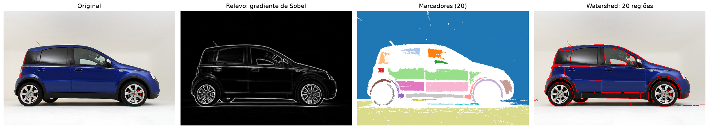

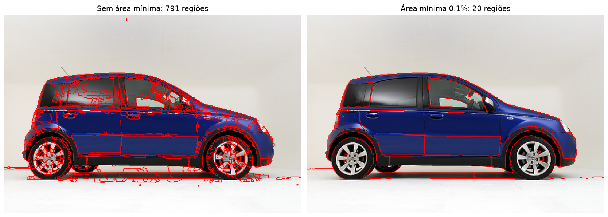

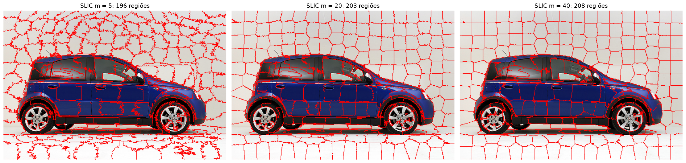

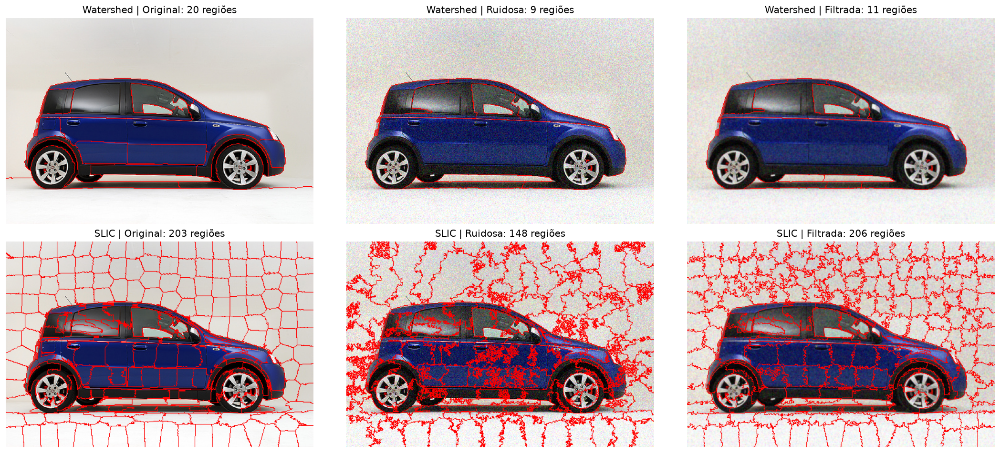

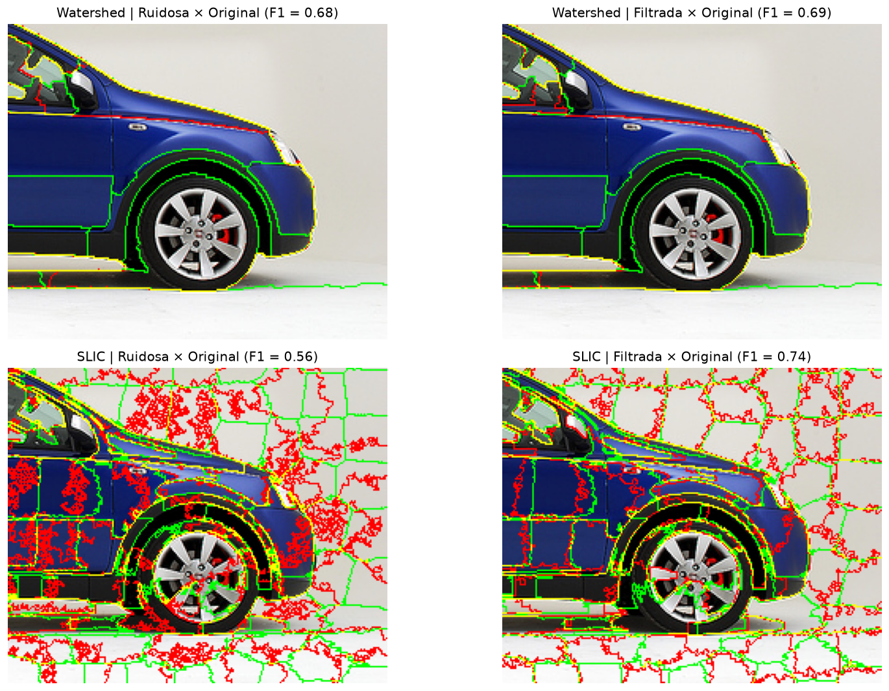

No recorte da frente do carro, o Watershed ruidoso aparece predominantemente em verde (bordas da referência perdidas, como o contorno interno dos para-lamas), e o SLIC ruidoso, em vermelho (fronteiras serrilhadas no fundo e na carroceria). No SLIC filtrado, pares de linhas vermelha e verde lado a lado no fundo indicam fronteiras apenas deslocadas, efeito esperado numa região lisa em que a posição das fronteiras é arbitrária.
### 4.3 Células — João Paulo
O limiar de Otsu foi 0,500 na Imagem 1, que só tem os níveis 0 e 1, e 0,771 na Imagem 2, entre o fundo branco e as hemácias. A Tabela 2 mostra a contagem própria após cada etapa e a área total de objeto.

| Imagem | Etapa | Objetos | Variação | Pixels de objeto |
|---|---|---:|---:|---:|
| Imagem 1 | Limiarizada | 17 | | 92.581 |
| Imagem 1 | Fechamento | 17 | 0 | 92.653 |
| Imagem 1 | Preenchimento | **16** | **−1** | 98.963 |
| Imagem 1 | Abertura | 16 | 0 | 98.963 |
| Imagem 2 | Limiarizada | 60 | | 466.102 |
| Imagem 2 | Fechamento | 59 | −1 | 466.488 |
| Imagem 2 | Preenchimento | 59 | 0 | 540.076 |
| Imagem 2 | Abertura | **56** | −3 | 539.834 |

*Tabela 2 — Contagem por etapa (8-vizinhança). Dados em `resultados/celulas/contagem_etapas.csv`.*

Na **Imagem 1**, a única mudança de contagem ocorre no preenchimento, de 17 para 16. Depois da limiarização, um ponto branco de 5 pixels dentro do buraco de um anel é contado como objeto independente; ao preencher o buraco, ele é incorporado ao anel. O preenchimento acrescentou 6.310 pixels (os buracos centrais). Três anéis cortados pela borda permanecem ocos, porque o buraco deles toca a borda e é tratado como fundo. Dois anéis que se tocam formam um único objeto (rótulo 4 na figura de resultado), de modo que os 16 objetos correspondem a 17 anéis.

Na **Imagem 2**, o preenchimento acrescentou 73.588 pixels, o centro claro das hemácias, sem alterar a contagem: uma hemácia com centro claro já era um anel, ou seja, um único componente. O fechamento uniu dois componentes (60 → 59), e a abertura removeu três partículas de 13 a 32 pixels, resíduos de corante (59 → 56). Na imagem final, a área mediana de um objeto é 9.252 pixels, e 8 objetos têm mais de 1,5 vez essa área (até 3,1 vezes), sinalizando candidatos a aglomerados. O critério de área é heurístico e não comprova, sozinho, quantas células compõem cada objeto. Na figura de rótulos, aparecem com uma única cor cobrindo duas ou três células. A célula maior e escura no centro da imagem é contada como mais um objeto.

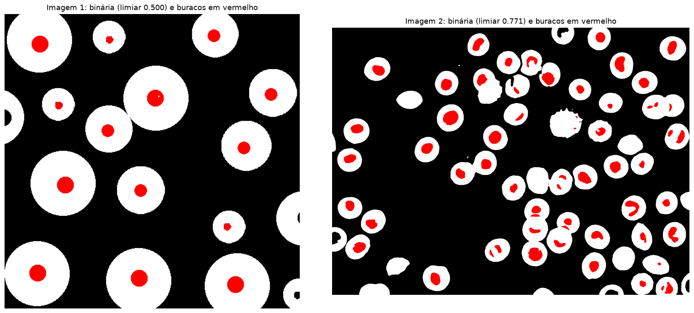

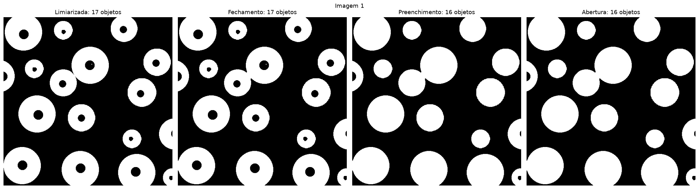

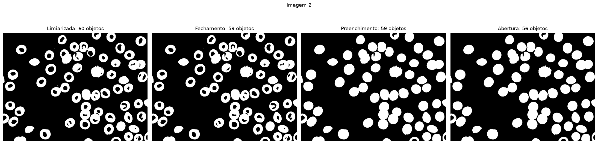

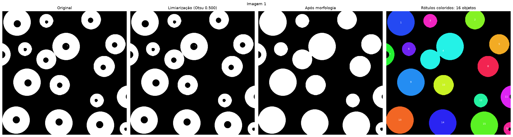

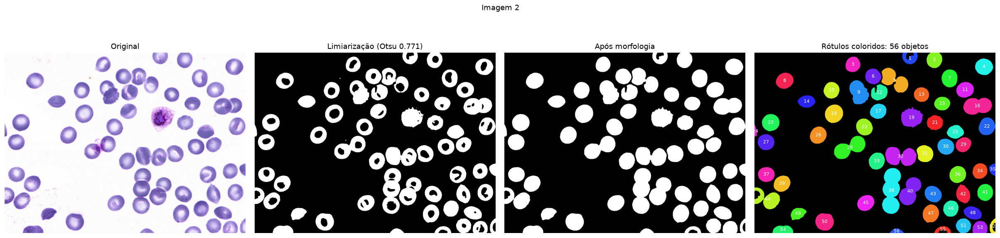

## 5. Discussão e limitações — todos
Na Parte 1, o ganho de restauração de 3,5053 dB acompanha um aumento de F1 de estabilidade de 0,561 para 0,736 no SLIC, mas apenas de 0,679 para 0,685 no Watershed. Os efeitos dependem do segmentador e não devem ser generalizados a outras imagens. A tabela conjunta está em `resultados/comparacao_parte1.csv` e no notebook principal.

A comparação usa os mesmos hiperparâmetros, mas o valor numérico do limiar do Watershed é recalculado pelo percentil de cada entrada. Assim, o resultado inclui a resposta desse procedimento adaptativo ao ruído. No zoom, as cores indicam coincidência exata entre pixels de contorno; as métricas da tabela aceitam deslocamentos de até 2 pixels.

**Morfologia e contagem (João Paulo).** O efeito do gap-filling sobre a contagem depende do tipo de falha. Ele muda o número de objetos quando há um componente falso dentro de um buraco, como o ponto da Imagem 1, mas não quando o buraco só torna a célula oca, como nas hemácias da Imagem 2: um anel já é um único componente conexo. Nesse caso, o ganho do preenchimento está na área e na forma de cada célula (73.588 pixels recuperados), o que importaria para medidas por célula, e não no número. Na Imagem 2, a fonte principal de erro na contagem são as **células encostadas**, que nenhuma das operações pedidas separa: o fechamento tende a uni-las ainda mais (em teste de sensibilidade registrado pelo grupo com raio 6, a contagem após o fechamento caiu de 60 para 51), e a abertura só as separaria se a ligação entre elas fosse mais estreita que o elemento. Separá-las exigiria, por exemplo, Watershed sobre a transformada de distância, que o enunciado deixa fora desta parte.

As limitações são: (i) não há contagem manual de referência, então não é possível medir o erro absoluto; os 8 objetos grandes da Imagem 2 são apenas candidatos a aglomerados; (ii) os raios e o $\sigma$ foram escolhidos por inspeção visual nestas duas imagens; (iii) células cortadas pela borda contam como objetos inteiros e, se o buraco toca a borda, não são preenchidas; (iv) o limiar global de Otsu supõe iluminação uniforme e dois grupos de intensidade, o que vale para as duas imagens, mas não para microscopia com fundo irregular; (v) com $\sigma=2$, o tempo na Imagem 2 (1600 × 1200) foi de cerca de 4 s para a morfologia e 1 s por contagem.

**Segmentação (Gustavo).** Watershed e SLIC respondem a perguntas diferentes. No Watershed, o número de regiões é determinado pelo conteúdo da imagem (quantos vales planos existem); no SLIC, é um parâmetro, e o resultado é uma pré-segmentação em superpixels de tamanho semelhante, adequada para ser agrupada por outro algoritmo. Os outros métodos vistos na disciplina não atenderiam à comparação pedida nesta imagem: a limiarização de Otsu separa apenas por intensidade e gera regiões desconexas, e um único limiar não separa carroceria azul, pneus, vidros, reflexos e fundo claro; o k-means apenas por cor agrupa pixels distantes de mesma cor, problema que o SLIC resolve ao incluir a posição na distância; o detector de Canny produz bordas que não se fecham em regiões contáveis; e o crescimento de regiões depende de sementes e limiar escolhidos manualmente, enquanto o Watershed com marcadores obtém as sementes e a ordem de crescimento do próprio relevo.

As principais limitações são: (i) sem gabarito, a métrica mede estabilidade em relação à segmentação da original, não acerto; uma borda errada na original também é tratada como referência; (ii) no fundo liso, as fronteiras do SLIC são arbitrárias e qualquer perturbação as desloca, o que penaliza a precisão mesmo onde não há objeto; (iii) foi usada uma única imagem e uma única realização do ruído; (iv) os parâmetros (percentil 75, área 0,1%, $K=200$, $m=20$) foram escolhidos por inspeção visual e não otimizados; (v) a métrica não faz o pareamento um-para-um do BSDS, de modo que um contorno espesso pode corresponder mais de uma vez; (vi) os laços em Python tornam imagens acima de cerca de 1000 pixels de lado lentas (vários segundos por método).

## 6. Conclusão — todos
Os experimentos demonstram que a eficácia do pré-processamento depende da medida e da etapa de análise. Na imagem natural utilizada, o filtro Gaussiano de corte 0,25 ciclos/pixel reduziu o erro de restauração, com ganho de 3,5053 dB no PSNR. Essa escolha recuperou parte da estabilidade dos contornos do SLIC, cujo F1 passou de 0,561 para 0,736, mas pouco alterou o Watershed, de 0,679 para 0,685. Portanto, escolher um filtro por PSNR não garante melhora equivalente em todos os segmentadores.

Na Parte 2, o preenchimento de buracos corrigiu a área e a forma dos objetos. Na Imagem 1, ele também incorporou um pequeno componente interno a um anel, reduzindo a contagem de 17 para 16. Na Imagem 2, o preenchimento manteve 59 objetos após o fechamento, enquanto a abertura reduziu o total para 56 ao remover pequenas partículas. A contagem final corresponde a componentes conectados e pode subestimar o número de células quando há contato entre elas.

As conclusões se restringem às três imagens, aos parâmetros e à realização de ruído examinados. Não há gabarito humano de segmentação nem contagem manual validada para calcular acurácia absoluta. Como continuidade, seria possível ampliar as imagens e seeds, avaliar sensibilidade de parâmetros e incorporar referências humanas. Nesta entrega, as intermediárias, métricas e testes tornam explícitos tanto os efeitos desejados quanto as falhas observadas.

## Referências
- Enunciado do Trabalho M2 e material de filtragem no domínio da frequência, Professor Felipe Viel, disciplina de Processamento de Imagens.
- NumPy. Discrete Fourier Transform. https://numpy.org/doc/stable/reference/routines.fft.html
- PASCAL VOC2012. https://www.robots.ox.ac.uk/~vgg/projects/pascal/VOC/voc2012/
- Dados da imagem e extração do pacote oficial: `data/README.md` e `data/metadados/2009_003974.json`.
- Material "Prática - Algoritmos de Segmentação", Professor Felipe Viel, disciplina de Processamento de Imagens. https://github.com/VielF/ColabProjects/tree/main/PDI
- BEUCHER, S.; MEYER, F. The morphological approach to segmentation: the watershed transformation. In: DOUGHERTY, E. R. (ed.). *Mathematical Morphology in Image Processing*. New York: Marcel Dekker, 1993. p. 433–481.
- ACHANTA, R. et al. SLIC superpixels compared to state-of-the-art superpixel methods. *IEEE Transactions on Pattern Analysis and Machine Intelligence*, v. 34, n. 11, p. 2274–2282, 2012.
- MARTIN, D. R.; FOWLKES, C. C.; MALIK, J. Learning to detect natural image boundaries using local brightness, color, and texture cues. *IEEE Transactions on Pattern Analysis and Machine Intelligence*, v. 26, n. 5, p. 530–549, 2004.
- Imagens da Parte 2: repositório do Professor Felipe Viel, `dataset/OperacaoMorfologia`. https://github.com/VielF/ColabProjects/tree/main/dataset/OperacaoMorfologia
- GONZALEZ, R. C.; WOODS, R. E. *Digital Image Processing*. 4. ed. New York: Pearson, 2018. Cap. 9: Morphological Image Processing.
- OTSU, N. A threshold selection method from gray-level histograms. *IEEE Transactions on Systems, Man, and Cybernetics*, v. 9, n. 1, p. 62–66, 1979.
