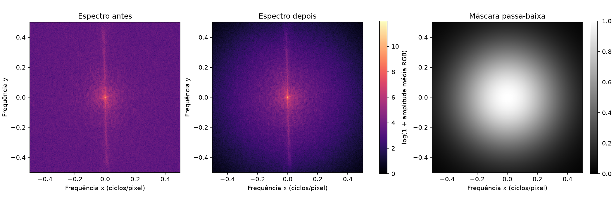
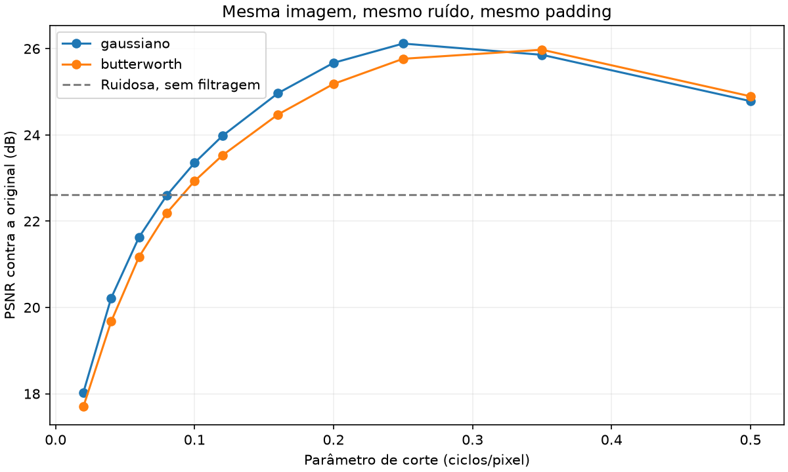

# Projeto M2 — Filtragem na frequência, morfologia e segmentação

Autores: Heloisa Cavalcante Born, Gustavo Corrêa de Mello e João Paulo Jorge Aimi. Completar curso e identificação acadêmica.

## 1. Enunciado e contexto
Apresentar problema, objetivos e requisitos. Referenciar o enunciado da disciplina.

## 2. Materiais e metodologia
### 2.1 Dados e reprodutibilidade — todos
Fontes das três imagens, ambiente, seed, parâmetros e convenções.
### 2.2 Filtragem na frequência — Born
A imagem original VOC2012 `2009_003974.jpg`, RGB de 500 × 335 pixels, foi convertida manualmente de inteiros de 8 bits para float64 em [0,1], sem redimensionamento. Adicionou-se ruído gaussiano de média zero e desvio padrão 0,08, independente por canal, com gerador NumPy e seed 42. Os valores foram limitados a [0,1]; portanto, o ruído efetivo sofre alteração perto dos extremos.

Implementaram-se duas máscaras passa-baixa radiais: Gaussiana, $H_G(D)=\exp[-D^2/(2D_0^2)]$, e Butterworth, $H_B(D)=1/[1+(D/D_0)^{2n}]$, com ordem $n=2$. A distância $D$ é calculada na grade de frequências em ciclos/pixel. A grade de $D_0$ foi 0,02; 0,04; 0,06; 0,08; 0,10; 0,12; 0,16; 0,20; 0,25; 0,35 e 0,50. O mesmo parâmetro não implica respostas equivalentes entre as famílias: o ganho em $D_0$ é aproximadamente 0,607 no Gaussiano e 0,5 no Butterworth.

Aplicou-se padding refletido de 32 pixels em cada borda. Para cada canal, calculou-se FFT2 e centralização, multiplicou-se o espectro complexo pela máscara e aplicou-se a transformada inversa após desfazer a centralização. A parte real foi recortada ao tamanho original e limitada a [0,1], sem normalização por mínimo e máximo. NumPy fornece a FFT e operações numéricas; a máscara, a filtragem por multiplicação e as métricas foram implementadas no projeto.

Calculou-se $MSE=\frac{1}{N}\sum(I-I_f)^2$ sobre todos os pixels e canais e $PSNR=10\log_{10}(1/MSE)$, com a imagem limpa como referência. A comparação usa a mesma realização de ruído em todas as 22 configurações. O maior PSNR da grade define a entrada filtrada para a próxima etapa. Trata-se de ajuste demonstrativo com referência conhecida na mesma imagem/seed, sem validação independente. SSIM, opcional no enunciado, não foi incluído.

### 2.3 Watershed e SLIC — Gustavo
Princípios, implementações, parâmetros e método de comparação.
### 2.4 Morfologia e contagem — João Paulo
Limiarização, elemento estruturante, fechamento, preenchimento, abertura e conectividade.

## 3. Códigos importantes
Na frente da Born, `src/frequencia.py` implementa ruído, máscaras e filtragem; `src/metricas.py` implementa MSE e PSNR. O trecho central é:

```python
f = np.fft.fftshift(np.fft.fft2(padded, axes=(0, 1)), axes=(0, 1))
g = f * h[..., None]  # máscara comum aos canais RGB
inversa = np.fft.ifft2(np.fft.ifftshift(g, axes=(0, 1)), axes=(0, 1))
```

A máscara é calculada pelo grupo, multiplicando amplitudes complexas sem descartar a fase antes da inversa. O notebook `notebooks/rascunhos/01_frequencia.ipynb` apresenta as equações, executa o experimento e exibe as saídas. Acrescentar aqui os trechos importantes das demais frentes quando disponíveis.

## 4. Resultados
### 4.1 Filtragem — Born
A imagem ruidosa apresentou **PSNR de 22.6133 dB** e MSE de 0.00547858. O melhor resultado entre as 22 configurações avaliadas foi o filtro **Gaussiano com corte 0,25 ciclos/pixel**, com **26.1186 dB**, MSE de **0.00244423** e ganho de **3.5053 dB**. O melhor Butterworth na grade teve corte 0,35 e PSNR 25,9753 dB. A diferença é pequena e vale apenas para este experimento.

O corte Gaussiano 0,02 produziu 18,0294 dB, abaixo da imagem ruidosa: filtrar mais intensamente não implica melhor restauração. O corte 0,50 deixou mais ruído e atingiu 24,7833 dB. Isso evidencia a troca entre redução de ruído e preservação de detalhes.

Na inspeção do painel e do recorte comum da roda dianteira, o filtro escolhido reduz a granulação, mas suaviza detalhes das rodas, janelas e carroceria. Os espectros mostram atenuação das altas frequências, usando a mesma escala logarítmica antes e depois. O maior resíduo imaginário da inversa foi 4.806e-16, compatível com arredondamento numérico.







A tabela completa está em `resultados/frequencia/comparacao_filtros.csv`. Os arrays float64 em `entradas_segmentacao.npz` preservam os dados para Gustavo; os PNGs são cópias arredondadas para visualização. Parâmetros, versões e fonte estão em `parametros.json`.

O ganho de PSNR mede restauração e **não demonstra melhoria de Watershed ou SLIC**. Essa conclusão depende das próximas etapas. A imagem escolhida não tem máscara de segmentação declarada; não se usa sua caixa de detecção como referência pixel a pixel.

### 4.2 Segmentação — Gustavo, com montagem dos painéis pela Born
Mapas, contornos e número de regiões nas condições comparadas.
### 4.3 Células — João Paulo
As duas imagens, máscaras e rótulos; tabela de contagem por etapa.

## 5. Discussão e limitações — todos
Discutir falhas, sensibilidade e relações entre parâmetros e resultados, sem presumir melhoria.

## 6. Conclusão — todos
Relacionar evidências aos objetivos.

## Referências
- Enunciado do Trabalho M2 e material de filtragem no domínio da frequência, Professor Felipe Viel, disciplina de Processamento de Imagens.
- NumPy. Discrete Fourier Transform. https://numpy.org/doc/stable/reference/routines.fft.html
- PASCAL VOC2012. https://www.robots.ox.ac.uk/~vgg/projects/pascal/VOC/voc2012/
- Dados da imagem e extração do pacote oficial: `data/README.md` e `data/metadados/2009_003974.json`.

Completar as referências das outras frentes e padronizar a apresentação acadêmica antes da exportação final.
